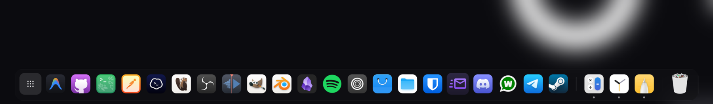
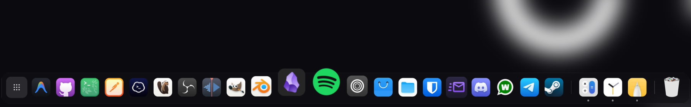
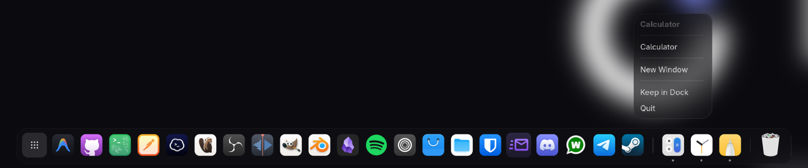

# Glass Dock for GNOME

A frosted-glass dock for GNOME Shell with macOS-style magnification, bouncing launches, badges and smart auto-hide.

<p align="center"></p>

Part of [himura-desktop](https://github.com/HIMURAw/himura-desktop), a set of GNOME extensions that share one look. Glass Dock also works fine on its own.

- [Features](#features)
- [Requirements](#requirements)
- [Install](#install)
- [Settings](#settings)
- [Other docks](#other-docks)
- [Colour themes](#colour-themes)
- [Troubleshooting](#troubleshooting)
- [Development](#development), [Translating](#translating), [License](#license)

## Features

<p align="center"></p>

**Layout.** The dock sits at the bottom of the screen. From left to right: the Show Apps button, your pinned apps, a thin separator, other apps that are open, another separator, and the trash. Apps that start or quit grow in and shrink away smoothly.

**Pinned apps are GNOME's favourites.** Pinning in the dock and pinning in GNOME's own dash or app grid change the same list.

**Magnification.** Icons grow under the pointer like a wave and the dock widens with them. Only the icon texture is scaled, so icons stay sharp. Set the strength in the settings, or turn it off.

**Running indicators.** A dot under an icon means the app has windows open; the dot of the active app is wider.

**Launch bounce.** An icon bounces while its app starts. An app that asks for attention bounces twice.

**Badges and progress bars.** Unread counts and progress bars that apps publish over the Unity LauncherEntry D-Bus API (for example Telegram, Discord, Thunderbird, or downloads in GTK apps) show on the icon. If an app quits without clearing its badge, the badge goes with it. Switch this off with `show-badges`.

**Name labels.** Hovering an icon shows the app's name above it.

**Mouse and touchpad**

| Action | What happens |
| --- | --- |
| Click | Opens the app or focuses its window. Clicking the active app again minimizes it (can be turned off). With several windows, each click goes to the next window. |
| Middle-click | Opens a new window (or just activates the app if it cannot open another). |
| Scroll over an icon | Switches between that app's windows. |
| Right-click | Opens the app's menu. |
| Drag an icon | Reorders pinned apps. |
| Drag an app in from the app grid | Pins it. |
| Drag a pinned icon well above the dock and let go | Removes it from the dock. |
| Click Show Apps | Opens GNOME's app grid (click again to close it). |
| Click the trash | Opens it in Files. The icon shows whether it is full or empty. |

**Menus.** Right-click an app to see its open windows, its desktop actions (New Private Window and the like), New Window, Keep in Dock or Remove from Dock, and Quit (Quit All Windows if it has several). Menus use the same frosted glass as the dock.

<p align="center"></p>

**Auto-hide.** The dock slides down out of the way, depending on the `auto-hide` setting:

- `never`: always visible. Windows keep clear of it.
- `fullscreen`: hidden while a window is fullscreen.
- `smart` (default): also hidden while a window reaches down under the dock.

Rest the pointer on the bottom edge of the screen for a moment to bring it back. In the Overview the dock steps aside for GNOME's own dash.

**Desktop icons.** If you use Desktop Icons NG (or a fork), the dock reserves its space so icons do not end up behind it.

## Requirements

- GNOME Shell **50** (see `metadata.json`). Other versions are not tested.
- To install from source you also need `gettext` (for `msgfmt`) and the GLib command-line tools (for `glib-compile-schemas`). Fedora: `sudo dnf install gettext glib2-devel`. Ubuntu/Debian: `sudo apt install gettext libglib2.0-bin`.

## Install

On Wayland, GNOME only picks up new extensions at login, so **log out and back in once after installing**.

### 1. With the himura-desktop installer

```bash
curl -fsSL https://raw.githubusercontent.com/HIMURAw/himura-desktop/main/install.sh | bash -s -- dock
```

### 2. From source

```bash
git clone https://github.com/HIMURAw/gnome-glass-dock.git
cd gnome-glass-dock
./install.sh
```

`install.sh` compiles the translations and the settings schema, links the folder into `~/.local/share/gnome-shell/extensions/glass-dock@himuraw` and enables the extension. Because it is a link, `git pull` updates the installed copy (log out and in to load the new code).

### 3. From a release zip

Download `glass-dock@himuraw.shell-extension.zip` from the [latest release](https://github.com/HIMURAw/gnome-glass-dock/releases/latest), then:

```bash
gnome-extensions install --force glass-dock@himuraw.shell-extension.zip
gnome-extensions enable glass-dock@himuraw
```

### Uninstall

```bash
gnome-extensions disable glass-dock@himuraw
rm -rf ~/.local/share/gnome-shell/extensions/glass-dock@himuraw
dconf reset -f /org/gnome/shell/extensions/glass-dock/   # optional: forget the settings
```

## Settings

Open the settings window with **Extensions > Glass Dock > Settings**, or:

```bash
gnome-extensions prefs glass-dock@himuraw
```

Changes apply straight away. The same options can be set from a terminal. Point `gsettings` at the extension's schema folder:

```bash
SCHEMAS=~/.local/share/gnome-shell/extensions/glass-dock@himuraw/schemas
gsettings --schemadir $SCHEMAS set org.gnome.shell.extensions.glass-dock icon-size 56
gsettings --schemadir $SCHEMAS set org.gnome.shell.extensions.glass-dock magnification 2.0
gsettings --schemadir $SCHEMAS set org.gnome.shell.extensions.glass-dock auto-hide 'fullscreen'
gsettings --schemadir $SCHEMAS list-recursively org.gnome.shell.extensions.glass-dock
```

| Key | Default | Effect |
| --- | --- | --- |
| `icon-size` | `48` | Icon size in pixels, 32 to 80. |
| `magnification` | `1.6` | How large icons grow under the pointer, 1.0 to 2.2. `1.0` turns magnification off. |
| `auto-hide` | `'smart'` | When the dock slides out of the way: `'never'`, `'fullscreen'` or `'smart'` (see [Features](#features)). |
| `blur` | `true` | Frosted glass. Turn it off for a plain dark dock on slower graphics. |
| `monitor` | `-1` | Which monitor the dock is on: `-1` is the primary monitor, `0` the first, `1` the second, and so on. The settings window only shows this choice when more than one monitor is connected. |
| `show-apps-button` | `true` | Show the Show Apps button on the left. |
| `show-running` | `true` | Show open apps that are not pinned. |
| `show-trash` | `true` | Show the trash on the right. |
| `show-badges` | `true` | Show unread counts and progress bars that apps report. |
| `click-minimizes` | `true` | Clicking the active app minimizes it. |

## Other docks

Two docks on one screen sit on top of each other, so **turn the others off**. The settings window shows a warning under Compatibility when it finds one of these enabled:

| Extension | Turn it off |
| --- | --- |
| Ubuntu Dock | `gnome-extensions disable ubuntu-dock@ubuntu.com` |
| Dash to Dock | `gnome-extensions disable dash-to-dock@micxgx.gmail.com` |
| Dash2Dock Lite / Animated | `gnome-extensions disable dash2dock-lite@icedman.github.com` |
| Dash to Panel | `gnome-extensions disable dash-to-panel@jderose9.github.com` |

Blur my Shell can stay installed, but turn off its blur for the dash: Glass Dock draws its own glass.

## Colour themes

On its own the dock is violet and needs nothing else. If you also use the **Mor** theme from [himura-desktop](https://github.com/HIMURAw/himura-desktop), its `tema-rengi` command recolours the dock live: Glass Dock watches `~/.config/tema/current.json` and swaps its stylesheet when the file changes, with no restart. The theme names it understands are `turkuaz`, `yesil`, `mavi`, `mor`, `cam` and `gri`; `cam` also gives the dock rounded corners. If the file is missing or unreadable, the dock stays violet.

## Troubleshooting

**The dock does not show up after installing.** Log out and back in; on Wayland a new extension is only loaded at login. Then check that it is enabled: `gnome-extensions list --enabled | grep glass-dock`.

**I see two docks.** Disable the other one, see [Other docks](#other-docks).

**An app has no badge or progress bar.** Only apps that publish through the Unity LauncherEntry API have them, and `show-badges` must be on.

**The dock feels slow.** Turn off `blur` for a plain dark dock.

**The settings window does not open.** Run `gnome-extensions prefs glass-dock@himuraw` in a terminal and read the messages.

**Logs.** Follow the shell's messages while you reproduce the problem:

```bash
journalctl -f -o cat /usr/bin/gnome-shell
```

For earlier messages from this boot: `journalctl -b -o cat /usr/bin/gnome-shell | grep -i -A5 "glass dock"`.

If a nested test session (see below) was killed rather than quit, delete `/run/user/$UID/gnome-shell-disable-extensions` if it exists, or your next login starts with extensions off.

When you report a bug, include your GNOME Shell version (`gnome-shell --version`) and the relevant log lines in an [issue](https://github.com/HIMURAw/gnome-glass-dock/issues).

## Development

Test in a nested session so you do not have to log out (settings and pinned apps are shared with your real session):

```bash
sudo dnf install mutter-devkit   # Fedora
./build.sh locale                # compiles translations and settings schemas
dbus-run-session gnome-shell --devkit --wayland
```

- `./build.sh pot` refreshes the translation template after you change strings.
- `./build.sh pack` builds `glass-dock@himuraw.shell-extension.zip` for extensions.gnome.org and releases.
- `npm install && npx eslint .` lints the code; CI runs the same on every push.
- Pushing a tag like `v1.1` publishes a GitHub release with the zip.

Bug reports and pull requests are welcome. Keep changes small and say which GNOME Shell version you tested on.

## Translating

The interface follows your system language. Available: English and Turkish. To add a language, copy `po/glass-dock@himuraw.pot` to `po/<language>.po`, fill in the `msgstr` lines, run `./build.sh locale` to check that it compiles, and open a pull request.

## License

GNU GPL version 3. See [LICENSE](LICENSE).
